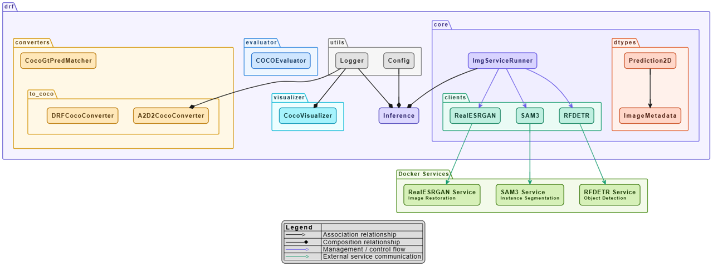

# Inference-Time Quality Optimization Framework (det-2d-refiner)

## Getting Started (Setup)
### Main (drf)
```bash
# Create a conda env
conda env create -f environment.yml
conda activate drf

# Install the project
pip install -e .

# If submodules were not initialized
git submodule update --init --recursive
```

### Modules
- Create Docker containers for each module based on the `README.md` file found in each module’s `docker/` folder.
- Based on which module is used by the framework, the relevant container for that module should be started at inference time, as it will function as an ML service.

## System Architecture
